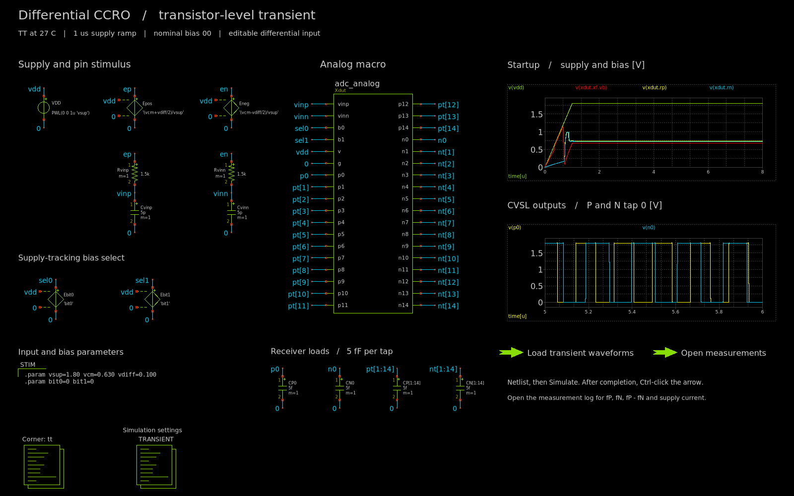

# Manual analog simulation in Xschem

Open the testbench from the repository root. It uses Xschem 3.4.4, ngspice 42, Python 3 and the SKY130A simulation PDK. On Windows with WSLg and Ubuntu 24.04, run:

```powershell
wsl -d Ubuntu-24.04 -- bash review/bench/open.sh
```

From Linux or a WSL shell, run `bash review/bench/open.sh`. If your PDK is installed elsewhere, set `REVIEW_PDK_ROOT` to the parent of `sky130A` in the Linux environment. The launcher prints the session directory under `/tmp/ccro-adc.*`. Each new window has its own results.

## Run and read the waveforms

1. On the top-level `tb_ccro.sch` sheet click **Netlist**, then **Simulate**. Wait for ngspice to finish. The first run includes loading the process models. Press **e** on `Xdut` to inspect the analog hierarchy and **Ctrl+e** to return before simulating.
2. Select the **Load transient waveforms** arrow and **Ctrl + left click** it. The upper graph shows the 1 µs supply ramp, reference bias `xdut.xf.vb` and local ring supplies `xdut.rp/rn`. The lower graph shows the full-swing tap-zero signals `p0` and `n0` between 5 and 6 µs. Zoom out on this graph for the slow bias. These two signals belong to different rings.
3. Activate **Open measurements** the same way. Near the end of the log, read `fp_mhz`, `fn_mhz`, `delta_mhz` (P minus N), and `idd_ua` (positive current drawn from VDD). Frequency is measured over two complete rising-edge intervals after 5 µs, at 0.90 V. Supply current is averaged from 5 µs to the end. The raw file also contains the actual pin voltages `vinp`, `vinn` and `i(vdd)`.
4. To try a different input, select the **STIM** parameter block, press **q**, and edit `value`. Run **Netlist**, **Simulate** and **Load transient waveforms** again. Re-running in the same window replaces that window’s results. Copy `tb_ccro.raw` and `tb_ccro.log` before the next run to keep a comparison.

| Initial setting | What it controls |
|---|---|
| `vsup=1.80`, `vcm=0.630`, `vdiff=0.100` (volts) | Both sources track the supply ramp. Settled VIN_P/VIN_N are 0.680/0.580 V. Change `vdiff` to `-0.100` to exchange them and check the sign of P minus N. |
| `bit1=0 bit0=0` | BIAS_SEL in **bit1, bit0** order. 00 nominal, 01 slow, 10 intermediate, 11 fast. When exploring 01 and 10 start within ±35 and ±95 mV respectively. The nominal run is 8 µs. The slow setting runs to 30 µs. |
| `CORNER=tt`, `.temp 27` | Change the `corner` property on **CORNER** or the temperature in **TRANSIENT**. A measurement without three post-5 µs rising edges has no valid frequency result. |

The DUT is the verified hierarchical analog schematic. Each input has a 1.5 kΩ series resistor and 5 pF fixture capacitor. All 30 CVSL outputs have 5 fF receiver loads. The oscillator starts from the supply ramp without an imposed phase or an injected pulse. This bench measures schematic-level analog behavior. The routed parasitics, digital readout, SPI and published PEX/SNDR results are covered by the project’s separate verification. [Verification evidence](../SUMMARY.md) · [Xschem graph controls](https://xschem.sourceforge.io/stefan/xschem_man/graphs.html)

## Reference run

TT, 27 °C, 1.80 V, nominal bias. The table uses the displayed schematic with 5 fF per receiver and a 5–8 µs current window. Independent threshold interpolation of the saved tap traces reproduces the frequency measurements.

| Differential input | P tap (MHz) | N tap (MHz) | P − N (MHz) | Mean supply (µA) |
|---:|---:|---:|---:|---:|
| +100 mV | 5.690820 | 4.745090 | +0.945730 | 41.967 |
| −100 mV | 4.746364 | 5.690733 | −0.944369 | 41.984 |



## Simulation files

The GUI and `bash review/bench/open.sh --batch` use the same ngspice runner. The session directory contains the Xschem netlist (`tb_ccro.spice`), simulator input (`tb_ccro.ngspice`), waveform file and log. For older Xschem versions that leave a SKY130 MOS geometry expression literal, the runner binds its W and nf to the values on the same generated instance and passes the PDK formula to ngspice. The PDK models, schematic devices and connectivity come from the installed PDK and the review sheets.
